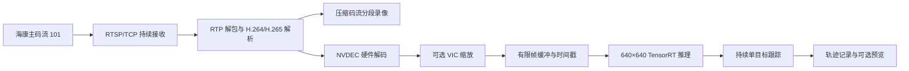

# 海康网络摄像机接入方案

> 2026-09-28 实现进度：已新增 `track_camera.py`、`camera_config.py`、`camera_app.py`、`rtsp_reader.py` 和独立 `gst_camera_worker.py`。默认完整模式采用分段落盘后顺序分析，低延迟模式采用同源录像与直接解码；录像管理并入 reader/worker，没有另建 `stream_recorder.py`。密码文件、静态检查、重连、坐标映射和全量录像重放已提供。当前完成静态/单元验证，真实摄像机尚未接入。实际命令与限制以 [CAMERA_USAGE.md](CAMERA_USAGE.md) 为准。

## 1. 已从相邻项目确认的配置

依据 `/home/mtr/Desktop/cam_test_bash/README.md`、`record.py`、`main.py` 的当前代码；本次为代码审查，尚未连接相机验证在线配置。

| 项目 | 脚本中的配置 |
|---|---|
| 标注型号 | 海康 DS-2CD2686FWDA2-IZS |
| 默认主机 | `192.168.1.64` |
| 默认 RTSP 端口 | `554` |
| 默认账户 | `admin` |
| 默认通道 | `1` |
| 默认传输 | RTSP over TCP |
| 主码流路径 | `/Streaming/Channels/101` |
| 子码流路径 | `/Streaming/Channels/102` |
| 第三码流路径 | 脚本可构造 `/Streaming/Channels/103`，固件是否支持需要探测 |
| 配置来源 | `HIKVISION_HOST`、`HIKVISION_USER`、`HIKVISION_PASSWORD`、`HIKVISION_CHANNEL` |
| 镜头控制 | HTTP/HTTPS ISAPI，HTTP Digest 认证 |

`record.py` 使用 PyAV 接收压缩包，从首个视频关键帧开始封装 MP4/MKV，没有图像解码和重新编码。`main.py` 提供变焦、调焦、一键聚焦及镜头能力探测；其 `probe` 主要检查镜头，不能替代视频流能力检测。

当前 drop 仍是本地文件入口，`Path.is_file()`、OpenCV 元数据预探测、总帧数及 EOF 逻辑均需要为实时源增加独立处理。现有系统 Python + GStreamer GI 的子进程可继续复用，不要求虚拟环境的 OpenCV 支持 GStreamer。

## 2. 推荐架构



长期方案采用一次 RTSP 会话，在解析后的压缩码流处拆出录像和分析分支。原始录像不需要 NVENC；只有重新绘制框的输出才需要编码。

第一阶段先完成实时读取和推理验收。调试期间可单独运行现有 `record.py` 留档，但这会建立第二个 RTSP 会话、增加一份码流网络流量，且两会话的时间轴需要校准。正式分支录像统一接收源和时间基，避免永久依赖两次取流。

实时解码管线由 SDP 的视频编码选择：

```text
rtspsrc（TCP）
  → rtph264depay → h264parse → nvv4l2decoder
或者
  → rtph265depay → h265parse → nvv4l2decoder
  → nvvidconv → BGRx appsink → 共享内存 → BGR → 现有检测器
```

仅连接视频 pad。用户名和密码通过 `rtspsrc` 属性设置，沿用环境变量，不把密码写入命令行、性能报告或异常文本。

## 3. 分阶段实现

### 阶段一：保持图像条件，打通实时输入

- 新增 `track_camera.py`，独立提供 host、port、channel、stream、transport、连接超时和可选运行时长；默认复用相邻项目的环境变量。
- 新增摄像机配置和 RTSP reader 模块，保持 `track_video.py` 的离线入口。
- 扩展 `gst_decoder_worker.py` 支持 RTSP 源：动态视频 pad、H.264/H.265 识别、PLAYING 后读取实际尺寸/FPS、首帧超时、GStreamer bus 错误和持续接收。
- 当前文件 worker 的逐次 `N` 请求模式不能直接当作网络流接收器：接收线程必须持续运行，帧的交付和消费分开；共享缓冲有明确所有权，防止覆盖推理正在使用的帧。
- 第一轮保持摄像机主码流现有分辨率和编码、4K 解码尺寸，使用当前 YOLO26s / 640 TensorRT engine，默认每帧检测、持续跟踪。
- 初始关闭带框视频写出，仅输出轨迹与性能；减少硬件编码故障对 RTSP 接入验证的干扰。

### 阶段二：分段保存原始码流

- 在解码前分支，使用 `splitmuxsink` 封装 MP4，按约 60 秒切段，分界实际落在关键帧，不能保证精确 60 秒。
- 已完成片段独立可读；当前未完成片段不宣称断电可恢复。等待首个可解码关键帧再开始有效录像。
- 录像清单记录 `session_id`、原始 PTS 范围、接收时间范围、文件状态；检测结果使用同一来源时间基定位录像。
- 两分支有独立的有限队列和错误监控。磁盘异常明确告警；不能只靠 `tee + queue` 就声称录像和推理永不互相阻塞。
- 明确磁盘容量上限；未经配置不循环删除旧录像，空间不足时报告保存失败。

### 阶段三：优化硬件缩放和摄像机编码

1. 在实时接入稳定后，于 NVDEC 后通过 VIC 缩放，再把小图交给 Python，减少 4K BGRx 拷贝。
2. 依次对照原尺寸、1280×720、640×360；这些为候选实验尺寸，不能直接视作已通过精度验证。
3. 推理仍使用同一 640×640 engine，输出坐标统一映射回源视频尺寸，记录缩放比例。跟踪噪声参数与坐标系保持一致。
4. 使用同一份原始录制码流重放比较缩放前后的检测结果，排除不同拍摄时刻的场景差异。
5. 摄像机 H.264/H.265 对照保持分辨率、帧率和接近的目标细节质量；改变编码格式不会自动减少解码后的 4K 图像大小。

先使用主码流 101。子码流 102 的实际分辨率和画质需查询，不能假设支持 1080p；之前提前转成 640×360 的检测帧数由 55 降到 41，因此不直接默认采用低分辨率子码流。

## 4. 实时语义与异常处理

### 时间与目标状态

- 每帧携带源 PTS、接收单调时刻、session_id 和本会话序号。
- Kalman 使用相邻有效源帧的时间差；不把处理耗时当作目标运动时间。
- 记录“接收至结果”的本机延迟和排队时间。没有相机时钟同步及可靠时间映射时，不把这些数字称为“曝光至结果”的端到端延迟。
- 网络连接状态独立于目标状态；断流不能冒充“目标正常消失”或视频 EOF。
- 断线结束当前轨迹段，原因 `stream_disconnect`；重连后创建新会话、重置滤波和类别状态，等待新目标，避免跨断流误拼轨迹。
- 镜头变焦/调焦继续由原 `main.py` 独立控制。正式分析时保持镜头稳定；调整镜头后重新开始轨迹段。

### 初始连接参数（待实机验证）

| 参数 | 建议起点 |
|---|---|
| transport | TCP，与已有 recorder 一致 |
| jitter buffer | 200 ms，可配置，不代表总延迟只有 200 ms |
| 连接/无有效视频帧超时 | 5 秒，分别监测 |
| 重连退避 | 1、2、4、8 秒，最大 30 秒 |
| 原始图像排队 | 1–2 帧，记录深度和等待时间 |
| 模型 | 当前 YOLO26s，TensorRT FP16，640×640 |

### 处理跟不上时的策略

保留两种明确模式，不把跳帧藏在缓冲设置中：

- **完整分析（建议默认）**：接收到的压缩码流先保存，正常时在线分析；持续落后时按录像顺序补算，报告积压，允许结果延迟。实现该模式必须有分段索引、补算检查点和去重，不能仅靠增大内存队列。网络中断仍可能丢失内容，必须记录缺口。
- **低延迟分析（显式选用）**：优先最新的已解码帧，记录每次跳过的帧/时间区间；跟踪按真实 PTS 推进。跳帧可能漏掉短暂出现的物体，不能承诺逐帧检测完整性。尽量在解码后丢旧帧，避免任意丢压缩参考帧导致后续帧无法解码。

如果持续处理速度低于摄像机帧率，有限资源下无法同时保证全部帧被分析和长期低延迟；正式部署需根据实测选定策略。完整录像也不能把网络本身丢失的内容恢复出来。

## 5. 预计代码范围

以下新增文件是设计名称，尚未实现：

| 文件/模块 | 工作 |
|---|---|
| `track_camera.py`（新增） | 实时 CLI，运行时长、退出与重连管理 |
| `tracking/camera_config.py`（新增） | 海康地址、通道、凭据与脱敏 |
| `tracking/rtsp_reader.py`（新增） | 实时帧接口、连接事件、有限交付缓冲 |
| `tracking/gst_decoder_worker.py` | 增加 RTSP、视频 caps、PTS 与状态事件 |
| `tracking/stream_recorder.py`（新增） | 压缩码流分段、清单与保存状态 |
| `tracking/app.py` | 提取可复用处理循环，分离实时与文件生命周期 |
| `tracking/detection.py` | 明确流中断时结束/重置轨迹；复用正常跟踪逻辑 |
| `tracking/performance.py` | 接收率、分析率、排队、重连、跳帧/积压统计 |

不需要复制镜头控制功能，不需要为基础接入重建当前 TensorRT engine，也不需要把相邻项目全部依赖引入 drop。

## 6. 验收顺序

1. 从 SDP/实际视频 caps 确认 101 的编码、尺寸和帧率；仅 TCP 554 可连接不能算取流成功。
2. 同时留档和分析同一主码流，确认像素尺寸、PTS、序号、录像与轨迹的对应关系。
3. 主动断开并恢复网络，检查超时、退避、重新等待关键帧及旧轨迹终止。
4. 运行至少 10 分钟，检查内存稳定、源帧率、分析帧率、排队时间、积压/跳帧和录像状态。
5. 重放同一录像，比较实时结果和离线结果；有意跳过的帧、重连区间单独计数。
6. 再做至少 300 帧、三轮的缩放/编码对照；检测差异需结合画面或标注判断，不能只凭 FPS 接受优化。

## 参考

- 现有连接与录像：`/home/mtr/Desktop/cam_test_bash/record.py:28`、`:185`。
- 镜头控制：`/home/mtr/Desktop/cam_test_bash/main.py:137`。
- [GStreamer rtspsrc：TCP/UDP、SDP、认证和缓冲](https://gstreamer.freedesktop.org/documentation/rtsp/rtspsrc.html)
- [GStreamer splitmuxsink：按关键帧切分录像](https://gstreamer.freedesktop.org/documentation/multifile/splitmuxsink.html)
